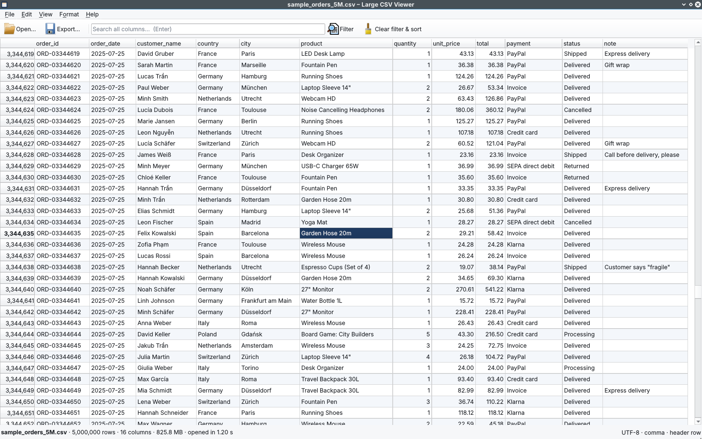
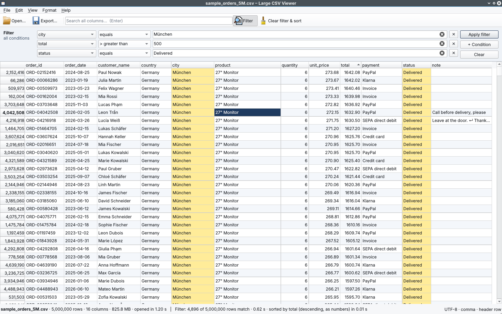
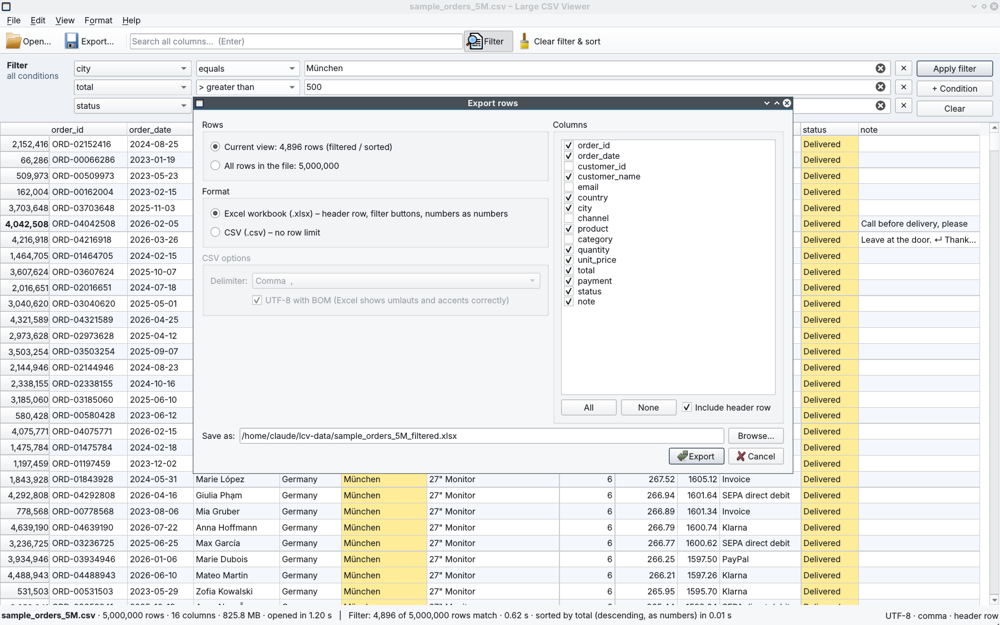

# Large CSV Viewer (C++ / Qt) — Demo project

A fast desktop app for CSV files that are too big for Excel. Opens a file with millions of rows in about a
second, scrolls smoothly, searches and filters by column, sorts, and exports the result to a small Excel file.

> **Demo project.** All screenshots and numbers use a fictional sample file (5,000,000 orders, 826 MB) that the
> app creates itself (*File → Create sample CSV…*). Names and e-mail addresses are invented (`@example.com`).



## Why

Excel stops at 1,048,576 rows and becomes very slow long before that. Exports from shop systems, ERPs,
web analytics or bank systems are often bigger. This viewer opens them read-only, lets you find the rows you
need, and saves just those rows as `.xlsx` (or `.csv`) to work on in Excel.

## Features

- **Opens multi-GB files quickly**: the file is memory-mapped (not copied into RAM); a background thread
  finds where each row starts (8 bytes per row). The first rows show up immediately while the rest loads.
- **Smooth scrolling** through millions of rows: only the visible rows are parsed (with a small cache).
- **Search** all columns, or **filter** with several conditions (AND): contains, equals, starts/ends with,
  `>`, `>=`, `<`, `<=` (numbers, or text such as ISO dates), empty / not empty, regular expression.
  Runs on all CPU cores, with progress bar and *Cancel*. Matching cells are highlighted.
- **Sort** by clicking a column header: numbers as numbers, text case-insensitive, empty values last.
- **Export** the current view (filtered / sorted) or all rows, with chosen columns:
  - Excel `.xlsx`: bold header row that stays visible, filter buttons, numbers stored as numbers
    (IDs like `00123` stay text). Excel's row limit is checked before export.
  - CSV: comma, semicolon (German Excel) or tab, UTF-8 with BOM so Excel shows umlauts correctly.
- **Real-world CSV**: quoted fields with commas, `""` escapes and line breaks inside fields; `,` `;` tab `|`
  detected automatically; UTF-8 (with/without BOM) or Windows-1252 detected automatically; header row optional.
- Row numbers always show the **original row number** in the file, also after filtering and sorting.
- Hide/show columns (right-click a header), row details panel (F4), copy cells (Ctrl+C), go to row (Ctrl+G),
  drag & drop, recent files.

## Performance

Measured with `csvbench` (included) on a small **2-core** cloud VM; a normal 4–8 core PC is faster for
search, filter and sort, which use all cores.

| Task | 5 million rows, 826 MB | 20 million rows, 3.3 GB |
|---|---|---|
| Open and index the file | 1.0 s | 4.1 s |
| Search all 16 columns (`paypal`) | 1.1 s | 4.7 s |
| Filter: city = München AND total > 500 | 0.6 s | 2.3 s |
| Sort by a number column | 1.3 s | 6.5 s |
| Sort by a text column | 5.0 s | 29.5 s |
| Export the filtered rows to `.xlsx` | 0.16 s (6,744 rows) | 0.46 s (27,094 rows) |

## Screenshots

| Filter + sort | Export |
|---|---|
|  |  |

## Download (Windows)

`LargeCsvViewer-win64.zip`: unzip, double-click `LargeCsvViewer.exe`. No installation needed.
Click *Create a sample file (5 million rows)* to try it without your own data.

## Build from source

Requirements: Qt 6.4 or newer (Core, Gui, Widgets; Test for the tests), CMake 3.21+, a C++17 compiler.

**Windows (Qt Creator):** install Qt 6 with MinGW via the Qt Online Installer, open `CMakeLists.txt` in
Qt Creator, choose the *Release* kit, build. To run the exe outside Qt Creator, put the Qt DLLs next to it:
`windeployqt LargeCsvViewer.exe`.

**Command line (Linux or Windows):**

```bash
cmake -S . -B build -DCMAKE_BUILD_TYPE=Release -DCMAKE_PREFIX_PATH=/path/to/Qt/6.8.3/gcc_64
cmake --build build -j
ctest --test-dir build              # unit tests
./build/csvgen 5000000              # sample_orders_5M.csv (fictional data)
./build/LargeCsvViewer sample_orders_5M.csv
./build/csvbench sample_orders_5M.csv
```

zlib (for `.xlsx`): Qt for Windows already contains it; on Linux install `zlib1g-dev`.
Cross-compiling the Windows version on Linux: see `cmake/mingw-w64-x86_64.cmake`.

## How it works

```
src/core/                       no GUI, reusable (also used by tests and tools)
  CsvParser       RFC 4180 record scanner (state survives block borders), field splitting,
                  delimiter / encoding detection, number parsing (1,234.50 and 1.234,50)
  CsvDocument     memory-mapped file + background row index; rows parsed on demand
  RowFilter       conditions -> matching row numbers, parallel over all cores
  RowSorter       parallel key extraction, parallel sort + merge
  XlsxWriter      streaming .xlsx writer (ZipWriter + zlib deflate); 1 million rows never sit in RAM
  Exporter        .xlsx / .csv export to a temporary file (cancel never leaves a broken file)
  SampleGenerator fictional orders data, deterministic
src/app/                        Qt Widgets UI
  CsvTableModel   QAbstractTableModel over the document, optional row view (filter/sort result)
  MainWindow      toolbar, search, filter panel, status, background jobs with progress and cancel
tests/tst_core.cpp              Qt Test: parser, quotes/line breaks, encodings, filters, sorting, export
tools/csvgen.cpp, csvbench.cpp  sample generator and benchmark
```

## Limitations

- Viewer only: it does not edit the CSV file.
- Text sorting compares letters A–Z case-insensitively; accented letters sort after `z`.
- UTF-16 files are not supported (save them as UTF-8 first).

## License

Source code published for review as a portfolio project. Copyright (c) 2026 Tuan Dung Pham, all rights
reserved (see `LICENSE`). Need a tool like this for your own data? Contact me via Upwork.
The Windows package contains Qt 6 (LGPL v3, dynamically linked) and the MinGW runtime, see
`THIRD_PARTY_NOTICES.txt`.
